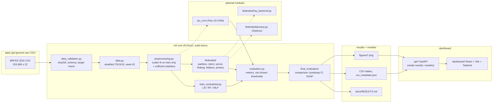

# MediFederate AI — Privacy-Preserving Federated Healthcare Intelligence

An enterprise-grade federated machine learning platform designed for clinical risk prediction across multi-center healthcare systems without transferring patient records outside institutional perimeters. Benchmarks centralized machine learning against federated optimization (FedAvg, FedProx) with formal differential privacy guarantees (Opacus DP-SGD) on the CDC BRFSS epidemiological cohort (253,680 records, 21 clinical indicators).

> **Clinical Decision Support Notice.** Multi-center federated topology configured across distributed health system nodes. Patient records remain strictly localized within each institution perimeter. Zero patient data egress architecture is enforced with formal differential privacy bounds (ε, δ). Clinical risk assessments serve as clinical decision support (CDS) and do not substitute for definitive medical diagnosis.

Documents: [Final research report](docs/FINAL_REPORT.md) · [Generated results tables](docs/RESULTS.md) · [Dataset documentation and citation](data/README.md) · [Requirement-to-artefact map](docs/REQUIREMENTS_MAP.md) · [Reproducibility checklist](docs/REPRODUCIBILITY.md) · [Federated methods](docs/federated_learning.md) · [Differential privacy](docs/differential_privacy.md) · [JAX and Ray](docs/jax_and_ray.md) · [Lightning AI Cloud](docs/LIGHTNING_AI.md) · [Dashboard](docs/DASHBOARD.md) · [Original plan](docs/PLAN.md)

## 1. Dataset

| Item | Value |
|---|---|
| Primary file | `diabetes_binary_health_indicators_BRFSS2015.csv` (SHA-256 `19f367e3…d8b1d0`, see `data/raw/MANIFEST.sha256`) |
| Dimensions | 253,680 rows × 22 columns (21 features + target); no missing cells |
| Target | `Diabetes_binary`: 1 = diabetes (13.93 %), 0 = otherwise. **Verified against the 3-class file: prediabetes is coded 0**, unlike the Kaggle/UCI description ("prediabetes or diabetes"). Labels were left unchanged and the discrepancy is documented. |
| Duplicates | 24,206 exact duplicate rows (9.5 %) kept, because identical coarse-coded survey answers are plausible; documented in `data/README.md` |
| Source | CDC Behavioral Risk Factor Surveillance System 2015, cleaned by Alex Teboul; Kaggle "Diabetes Health Indicators Dataset" (CC0 1.0); UCI ML Repository id 891, DOI 10.24432/C53919 |
| Citation | Teboul, A. (2021). *Diabetes Health Indicators Dataset* [Data set]. Kaggle. CDC (2015). *Behavioral Risk Factor Surveillance System Survey Data*. UCI Machine Learning Repository: *CDC Diabetes Health Indicators*, https://doi.org/10.24432/C53919 |

Full provenance, feature dictionary, license notes (UCI terms and CDC codebook were not independently verified) and limitations: [`data/README.md`](data/README.md). Validation artefacts: `results/dataset_summary.csv`, `results/validation_checks.csv`, `results/feature_statistics.csv`, `results/figures/target_distribution.png`.

## 2. Architecture



Single entry point: `python -m ml.run {centralized|federated|dp|jax|ray-benchmark} [--config …] [--set key=value] [--device cpu|cuda|auto]`.

## 3. Federated-learning workflow

```mermaid
sequenceDiagram
    participant S as Simulation harness
    participant Srv as Server (FederatedServer)
    participant C as Client k (1..5, simulated)
    participant T as Held-out test split
    S->>S: stratified split; partition train+val rows to clients (IID or Dirichlet); test never partitioned
    C->>Srv: sufficient statistics (count, sum, sum of squares) + label counts
    Srv->>Srv: fit shared scaler == pooled fit; pos_weight = n_neg / n_pos
    loop each round r = 1..R
        Srv->>C: broadcast global weights w_r (3,521 float32 = 14,084 B per client)
        C->>C: local SGD on own rows; FedProx adds (mu/2)||w - w_r||^2; DP variant clips per example + adds Gaussian noise
        C->>Srv: upload w_k, n_k (never raw rows)
        Srv->>Srv: FedAvg: w_{r+1} = sum_k (n_k / sum n) w_k
        Srv->>T: evaluate global model (reporting only; no decision uses the test split)
    end
    Srv->>S: thresholds chosen on validation; final test metrics; bytes, runtime, epsilon (DP)
```

Byte accounting counts raw float32 payload (download + upload) without compression or protocol overhead. Per-round seeds derive from `(seed, round, client)`, so runs are reproducible and resumable from checkpoints.

## 4. Installation (clean environment, Windows PowerShell shown; Linux/macOS equivalents in comments)

Requirements: Python 3.11, Node.js ≥ 20 (dashboard only), ~2 GB disk. Everything runs on CPU.

```powershell
git clone <your-private-remote> Federated-Healthcare-ML
cd Federated-Healthcare-ML
python -m venv .venv
.\.venv\Scripts\Activate.ps1                     # Linux/macOS: source .venv/bin/activate
python -m pip install --upgrade pip
python -m pip install torch==2.10.0 --index-url https://download.pytorch.org/whl/cpu
python -m pip install -r requirements.txt       # core: numpy, pandas, scikit-learn, matplotlib, pyyaml, pytest, opacus
python -m pip install -r requirements-optional.txt   # optional: jax, flax, optax, ray (JAX CNN + Ray benchmark)
python -m pip install -r requirements-api.txt   # optional: fastapi, uvicorn, httpx, shap (final evaluation + dashboard API)
```

Pinned versions were co-installed and checked with `pip install --dry-run` before use (no changes to torch/numpy/scikit-learn when adding JAX/Ray/Opacus). Tested environment: Windows 11, Python 3.11.8, torch 2.10.0+cpu, numpy 2.4.3, pandas 3.0.1, scikit-learn 1.8.0, opacus 1.6.0, jax 0.10.2, flax 0.12.8, optax 0.2.8, ray 2.59.0, shap 0.51.0, fastapi 0.135.1.

**Data.** Download the three CSVs from the Kaggle dataset page and place them in `data/raw/` (never commit them). Then verify:

```powershell
python -m ml.data_validation          # all checks must PASS, incl. sha256_matches_manifest
```

## 5. Execution (from the repository root)

```powershell
# 1. Dataset validation and EDA
python -m ml.data_validation
python -m ml.exploratory_analysis

# 2. Centralized baselines (LR, RF, MLP; 3 seeds)                        ~8 min
python -m ml.run centralized

# 3. Federated: FedAvg + FedProx, IID + Dirichlet(0.5), 5 clients, 3 seeds, local-only baselines   ~2 min
python -m ml.run federated --set "seeds=[0, 1, 2]" --set output_tag=final

# 4. Differential privacy (Opacus, example-level DP-SGD)                  ~6 min
python -m ml.run dp

# 5. Optional: JAX 1D-CNN vs PyTorch MLP                                   ~1.5 min
python -m ml.run jax

# 6. Optional: Ray distributed client execution vs sequential             ~1.5 min
python -m ml.run ray-benchmark

# 7. Final comparison tables, bootstrap CIs, SHAP, figures, docs/RESULTS.md   ~3 min
python -m ml.final_evaluation.report --config configs/final_evaluation.yaml

# 8. Tests (unit + end-to-end smoke on the real CSV)
python -m pytest -q

# 9. Dashboard (two terminals)
python -m uvicorn api.main:app --reload --port 8000
cd dashboard; npm install; npm run dev          # http://localhost:5173 ; tests: npm test; npm run build
```

Any YAML key can be overridden: `--set federated.rounds=30 --set federated.checkpoint_every=5`. Cloud/GPU instructions: [`docs/LIGHTNING_AI.md`](docs/LIGHTNING_AI.md) (`--device auto` for the PyTorch MLP; credentials are never placed in code).

## 6. Results (actual, from `results/final/final_comparison.csv`; test split, n = 38,052)

Operating point `val_max_f1` (threshold chosen on the validation split); mean ± std over 3 seeds; laptop CPU (12 logical cores).

| Setting | Method | ROC-AUC | PR-AUC | Recall (diabetes) | F1 (diabetes) | Accuracy | Train s | Rounds | Bytes |
|---|---|---|---|---|---|---|---|---|---|
| centralized | logistic regression (C=10) | 0.8200 ± 0.0000 | 0.3913 | 0.6243 | 0.4575 | 0.7937 | 0.7 | – | 0 |
| centralized | random forest (depth 20, leaf 20) | 0.8253 ± 0.0002 | 0.4180 | 0.6036 | 0.4655 | 0.8069 | 20.0 | – | 0 |
| centralized | MLP 64-32 (Adam, early stop) | **0.8276 ± 0.0005** | 0.4178 | 0.6055 | 0.4681 | 0.8083 | 45.1 | – | 0 |
| IID, 5 clients | local-only (mean of clients) | 0.8230 ± 0.0002 | 0.4068 | 0.6098 | 0.4624 | 0.8025 | 0.9 | – | 0 |
| IID, 5 clients | FedAvg (8 rounds) | 0.8176 ± 0.0009 | 0.3884 | 0.6272 | 0.4591 | 0.7941 | 3.0 | 8 | 1,126,720 |
| IID, 5 clients | FedProx μ=0.01 | 0.8175 ± 0.0009 | 0.3883 | 0.6267 | 0.4591 | 0.7942 | 3.4 | 8 | 1,126,720 |
| Dirichlet α=0.5 | local-only (mean; range 0.784–0.825) | 0.8136 ± 0.0023 | 0.3887 | 0.6683 | 0.3604 | 0.6380 | 1.0 | – | 0 |
| Dirichlet α=0.5 | FedAvg (8 rounds) | 0.8181 ± 0.0009 | 0.3922 | 0.6081 | 0.4592 | 0.8004 | 3.2 | 8 | 1,126,720 |
| Dirichlet α=0.5 | FedProx μ=0.01 | 0.8180 ± 0.0009 | 0.3920 | 0.6100 | 0.4594 | 0.8000 | 3.4 | 8 | 1,126,720 |
| IID | FedAvg + DP σ=4 (ε_max = 0.69, δ = 1e-5), 1 seed | 0.8172 | 0.4017 | 0.6086 | 0.4579 | 0.7992 | 53.0 | 8 | 1,126,720 |
| Dirichlet α=0.5 | FedAvg + DP σ=4 (ε_max = 2.34), 1 seed | 0.8162 | 0.4007 | 0.6292 | 0.4559 | 0.7908 | 50.1 | 8 | 1,126,720 |

Bootstrap 95 % CIs (500 test resamples, seed 0) are about ±0.005 ROC-AUC for every model (`results/final/bootstrap_ci.csv`). FedProx differs from FedAvg by ≤ 0.0001 AUC, below the seed std. DP at σ=4 costs ≤ 0.002 AUC in these runs. **Caveat stated in the report:** federated models ran only 8 rounds of SGD and their validation curves were still rising, while the centralized/local-only MLPs used Adam with early stopping; part of the ~0.01 gap is training budget, not decentralisation. All numbers above are copied from the generated CSV; the generated document [`docs/RESULTS.md`](docs/RESULTS.md) contains every row, the DP table, convergence, SHAP tables and limitations.

Figures (generated, under `results/final/figures/`): `final_comparison_roc_auc.png`, `confusion_matrices.png`, `convergence_val_auc.png`, `convergence_train_loss.png`, `communication_cost.png`, `iid_vs_noniid.png`, `shap_global_importance.png`, `shap_individual_*.png`. Earlier phases keep their own figures under `results/figures/`, `results/federated/<tag>/figures/`, `results/federated/dp/figures/`, `results/jax/figures/`.

## 7. Status: completed vs optional / unfinished

| Component | Status | Evidence |
|---|---|---|
| Dataset validation, EDA, provenance | Completed | `results/validation_checks.csv`, `data/README.md` |
| Centralized LR / RF / MLP (3 seeds) | Completed | `results/centralized_results.csv` |
| FedAvg, FedProx, 5 clients, IID + Dirichlet, local-only (3 seeds, 8 rounds) | Completed (short-budget run) | `results/federated/final/` |
| 30-round / 3-seed grid (`configs/federated.yaml`) | **Not run** (too slow on the laptop; config provided) | – |
| Differential privacy (σ ∈ {1, 4}, 1 seed) | Completed | `results/federated/dp/` |
| Final comparison, bootstrap CIs, SHAP | Completed | `results/final/`, `docs/RESULTS.md` |
| JAX 1D-CNN (15-epoch budget, 1 seed) | Completed, optional | `results/jax/` |
| Ray backend + benchmark | Completed, optional | `results/federated/ray/` |
| Lightning AI Cloud | Instructions only; **not executed** in the cloud (no account used) | `docs/LIGHTNING_AI.md` |
| GPU execution | Code path present (`--device`); **not exercised** (CPU-only torch build) | `tests/test_e2e_smoke.py::test_cuda_request_fails_loudly_on_cpu_build` |
| Dashboard (FastAPI + React) | Completed; verified locally in a browser | `api/`, `dashboard/`, `docs/DASHBOARD.md` |
| Tests | 115 Python tests + 8 frontend tests passed in the last run (see §9) | `tests/`, `dashboard/src/test/` |

## 8. Repository layout

```
api/                 FastAPI backend (aggregates + demo inference; never raw rows)
configs/             YAML configs for every experiment
dashboard/           React + TypeScript + Vite + Tailwind frontend
data/raw/            CSVs (git-ignored) + MANIFEST.sha256; data/README.md = dataset documentation
docs/                reports, methods, diagrams (this README), cloud + dashboard guides
ml/                  core library and experiments (see architecture diagram)
models/              saved models (git-ignored; derived from raw data)
results/             all CSV/JSON/PNG outputs; results/final/ = comparison tables and figures
tests/               pytest suite incl. end-to-end smoke test on the real CSV
```

## 9. Tests

Last full run on this machine (2026-10-15, after the audit fixes): `python -m pytest -q` → **115 passed in 62 s** (includes the end-to-end smoke test on the real CSV); `cd dashboard; npm test` → **8 passed**; `npm run typecheck` clean; `npm run build` succeeded. JAX/Ray/SHAP/FastAPI tests skip automatically when the optional packages are absent. Details and the requirement-by-requirement evidence: [`docs/REQUIREMENTS_MAP.md`](docs/REQUIREMENTS_MAP.md).
