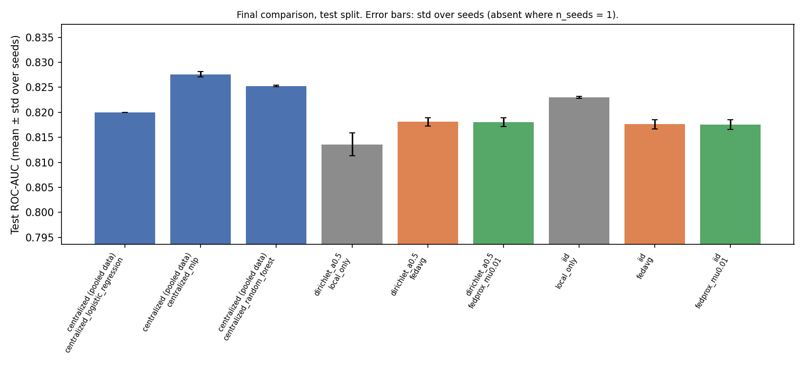
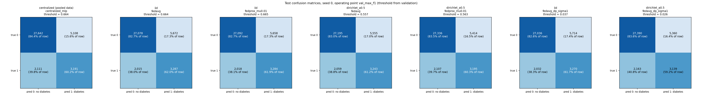
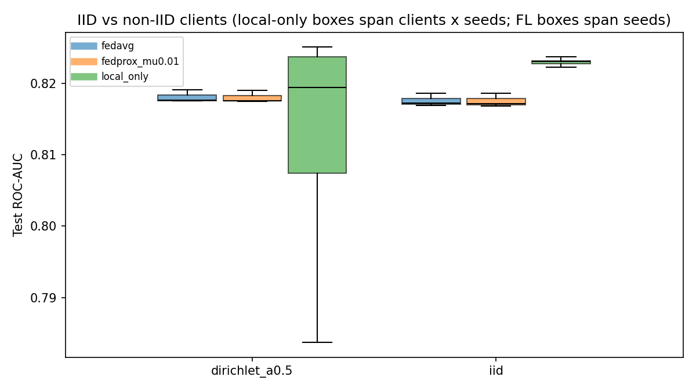
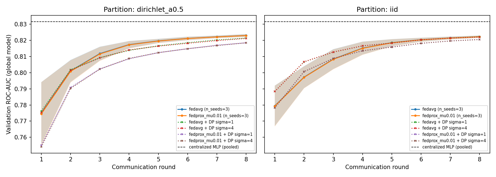
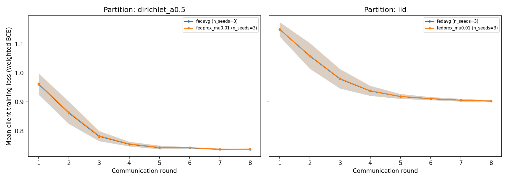
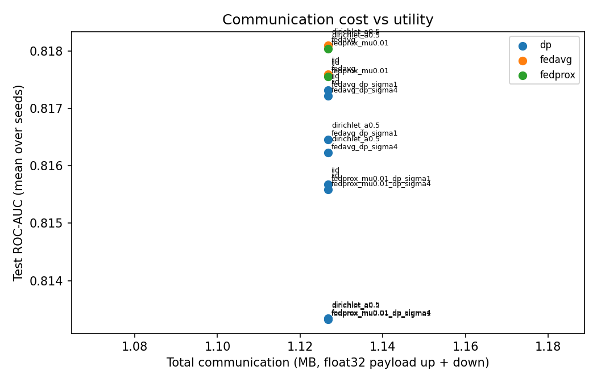
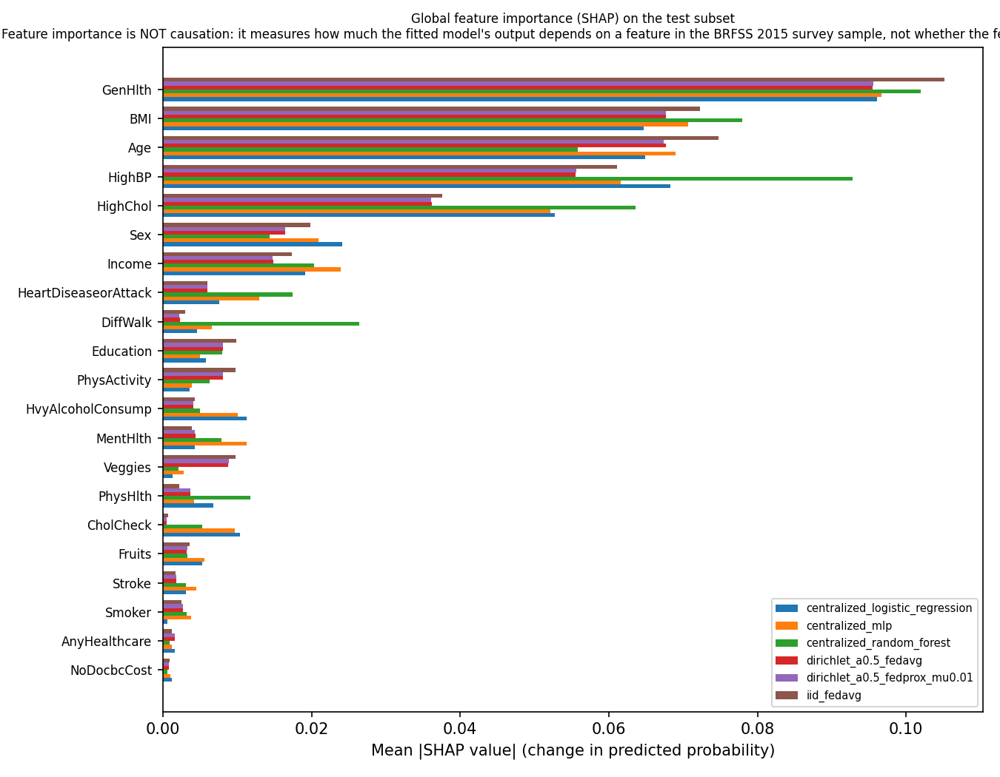
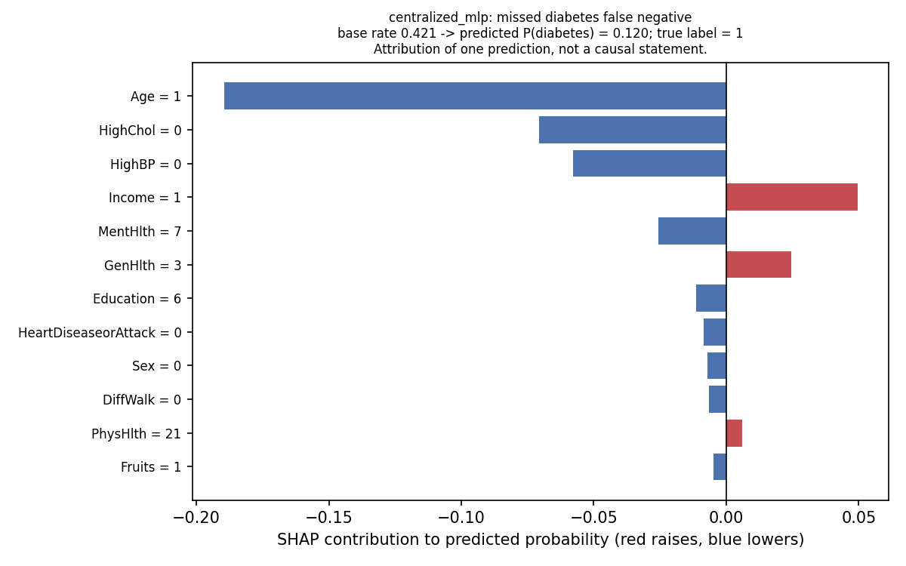

# Results: privacy-preserving federated learning for diabetes classification

> Clients are simulated partitions of a single public survey dataset (CDC BRFSS 2015). They are not hospitals or real institutions, and federated learning alone does not guarantee privacy: model updates can still leak information about training data.

> Feature importance is NOT causation: it measures how much the fitted model's output depends on a feature in the BRFSS 2015 survey sample, not whether the feature causes diabetes.

Generated 2026-10-15 03:24:59 +0530 by `python -m ml.final_evaluation.report` from saved outputs in `results/` (centralized seeds [0, 1, 2]; federated tags ['final'], seeds [0, 1, 2]; DP included). All tables below are rendered from CSV files in `results/final/`; no value is typed in by hand. Hardware: Windows-10-10.0.26200-SP0, 12 logical CPUs, CPU-only PyTorch 2.10.0+cpu.

## 1. Setup recap

- Data: CDC BRFSS 2015 diabetes indicators, 253,680 survey rows, 21 features, target `Diabetes_binary` (13.9% positive; the file codes prediabetes as 0, see `data/README.md`). Duplicates kept; labels unchanged.
- Split: stratified 70/15/15 (`split_seed=42`); test split n = 38,052 rows, never partitioned to clients, never used for thresholds or model selection.
- Operating point for threshold metrics: `val_max_f1` (threshold chosen on validation data only). ROC-AUC and PR-AUC are threshold-free.
- Clients: 5 simulated partitions of the training/validation rows: `iid` (stratified equal) and `dirichlet_a0.5` (label-skew Dirichlet, Hsu et al. 2019). Local-only = each client trains alone on its own rows.
- Centralized models: logistic regression (class-weighted), random forest (balanced subsample), PyTorch MLP (64-32, weighted BCE). Federated models: the same MLP trained with FedAvg / FedProx (`federated.rounds` rounds, 1 local epoch).

## 2. Final comparison (test split)

Mean ± std over seeds where more than one seed exists (`n_seeds`). Local-only rows are averaged over the 5 clients within each seed (per-client values: `results/final/local_only_by_client.csv`). Train time is wall-clock on the machine above; bytes are float32 model payload down + up over all rounds (0 for non-federated training, which moves raw data instead).

| setting | method | n_seeds | Accuracy | Precision (diabetes) | Recall (diabetes) | F1 (diabetes) | ROC-AUC | PR-AUC | Train s | Rounds | Bytes |
|---|---|---|---|---|---|---|---|---|---|---|---|
| centralized (pooled data) | centralized_logistic_regression | 3 | 0.7937 ± 0.0000 | 0.3610 ± 0.0000 | 0.6243 ± 0.0000 | 0.4575 ± 0.0000 | 0.8200 ± 0.0000 | 0.3913 ± 0.0000 | 0.7085 ± 0.0393 | 0 | 0 |
| centralized (pooled data) | centralized_mlp | 3 | 0.8083 ± 0.0080 | 0.3821 ± 0.0093 | 0.6055 ± 0.0285 | 0.4681 ± 0.0018 | 0.8276 ± 0.0005 | 0.4178 ± 0.0010 | 45.0862 ± 13.9125 | 0 | 0 |
| centralized (pooled data) | centralized_random_forest | 3 | 0.8069 ± 0.0042 | 0.3790 ± 0.0049 | 0.6036 ± 0.0158 | 0.4655 ± 0.0014 | 0.8253 ± 0.0002 | 0.4180 ± 0.0002 | 20.0021 ± 0.0988 | 0 | 0 |
| dirichlet_a0.5 | local_only | 3 | 0.6380 ± 0.0113 | 0.3253 ± 0.0106 | 0.6683 ± 0.0336 | 0.3604 ± 0.0251 | 0.8136 ± 0.0023 | 0.3887 ± 0.0027 | 0.9740 ± 0.0647 | 0 | 0 |
| dirichlet_a0.5 | fedavg | 3 | 0.8004 ± 0.0013 | 0.3689 ± 0.0015 | 0.6081 ± 0.0040 | 0.4592 ± 0.0008 | 0.8181 ± 0.0009 | 0.3922 ± 0.0008 | 3.1630 ± 0.1187 | 8 | 1,126,720 |
| dirichlet_a0.5 | fedprox_mu0.01 | 3 | 0.8000 ± 0.0041 | 0.3686 ± 0.0043 | 0.6100 ± 0.0135 | 0.4594 ± 0.0005 | 0.8180 ± 0.0009 | 0.3920 ± 0.0008 | 3.3919 ± 0.0232 | 8 | 1,126,720 |
| dirichlet_a0.5 | fedavg_dp_sigma1 | 1 | 0.8023 | 0.3693 | 0.5920 | 0.4549 | 0.8165 | 0.4001 | 58.2164 | 8 | 1,126,720 |
| dirichlet_a0.5 | fedavg_dp_sigma4 | 1 | 0.7908 | 0.3575 | 0.6292 | 0.4559 | 0.8162 | 0.4007 | 50.1442 | 8 | 1,126,720 |
| dirichlet_a0.5 | fedprox_mu0.01_dp_sigma1 | 1 | 0.7961 | 0.3621 | 0.6088 | 0.4541 | 0.8133 | 0.3936 | 56.6545 | 8 | 1,126,720 |
| dirichlet_a0.5 | fedprox_mu0.01_dp_sigma4 | 1 | 0.7992 | 0.3652 | 0.5981 | 0.4535 | 0.8133 | 0.3949 | 53.9046 | 8 | 1,126,720 |
| iid | local_only | 3 | 0.8025 ± 0.0028 | 0.3730 ± 0.0030 | 0.6098 ± 0.0105 | 0.4624 ± 0.0008 | 0.8230 ± 0.0002 | 0.4068 ± 0.0006 | 0.9023 ± 0.0082 | 0 | 0 |
| iid | fedavg | 3 | 0.7941 ± 0.0034 | 0.3621 ± 0.0041 | 0.6272 ± 0.0074 | 0.4591 ± 0.0018 | 0.8176 ± 0.0009 | 0.3884 ± 0.0012 | 2.9694 ± 0.0320 | 8 | 1,126,720 |
| iid | fedprox_mu0.01 | 3 | 0.7942 ± 0.0036 | 0.3622 ± 0.0044 | 0.6267 ± 0.0075 | 0.4591 ± 0.0020 | 0.8175 ± 0.0009 | 0.3883 ± 0.0012 | 3.3584 ± 0.0425 | 8 | 1,126,720 |
| iid | fedavg_dp_sigma1 | 1 | 0.7964 | 0.3640 | 0.6167 | 0.4578 | 0.8173 | 0.4017 | 20.3435 | 8 | 1,126,720 |
| iid | fedavg_dp_sigma4 | 1 | 0.7992 | 0.3670 | 0.6086 | 0.4579 | 0.8172 | 0.4017 | 53.0250 | 8 | 1,126,720 |
| iid | fedprox_mu0.01_dp_sigma1 | 1 | 0.7916 | 0.3583 | 0.6269 | 0.4560 | 0.8157 | 0.3982 | 50.7891 | 8 | 1,126,720 |
| iid | fedprox_mu0.01_dp_sigma4 | 1 | 0.7933 | 0.3605 | 0.6247 | 0.4571 | 0.8156 | 0.3983 | 52.1379 | 8 | 1,126,720 |

Source: `results/final/final_comparison.csv` (per-seed rows: `final_comparison_by_seed.csv`).

### 2.1 Bootstrap 95% confidence intervals (seed 0, 500 test resamples)

Confidence intervals quantify test-set sampling uncertainty for one trained model; seed std above quantifies training variability. They are different sources of variation and should not be added.

| model | roc_auc | roc_auc_ci_low | roc_auc_ci_high | f1_class1 | f1_ci_low | f1_ci_high | threshold |
|---|---|---|---|---|---|---|---|
| centralized_logistic_regression | 0.8200 | 0.8143 | 0.8255 | 0.4575 | 0.4470 | 0.4678 | 0.6173 |
| centralized_random_forest | 0.8252 | 0.8199 | 0.8308 | 0.4641 | 0.4538 | 0.4741 | 0.6150 |
| centralized_mlp | 0.8282 | 0.8230 | 0.8336 | 0.4692 | 0.4581 | 0.4796 | 0.6639 |
| dirichlet_a0.5_fedavg | 0.8191 | 0.8135 | 0.8245 | 0.4600 | 0.4502 | 0.4709 | 0.5572 |
| dirichlet_a0.5_fedprox_mu0.01 | 0.8190 | 0.8135 | 0.8244 | 0.4593 | 0.4495 | 0.4706 | 0.5627 |
| iid_fedavg | 0.8186 | 0.8132 | 0.8239 | 0.4610 | 0.4513 | 0.4716 | 0.6642 |
| iid_fedprox_mu0.01 | 0.8186 | 0.8132 | 0.8239 | 0.4611 | 0.4514 | 0.4718 | 0.6646 |

Source: `results/final/bootstrap_ci.csv`.





## 3. Centralized vs local-only vs FedAvg vs FedProx

- **dirichlet_a0.5**: centralized MLP 0.8276; local-only mean 0.8136 (client range 0.7837–0.8251); FedAvg 0.8181; fedprox_mu0.01 0.8180.
  FedAvg trails the centralized MLP by 0.0095 ROC-AUC (centralized seed std 0.0005, FedAvg seed std 0.0009).
  fedprox_mu0.01 vs FedAvg: -0.0001 ROC-AUC (smaller than the seed-to-seed std, so not distinguishable here).
  Local-only vs FedAvg: -0.0045 on average; the weakest client is -0.0344 from FedAvg.
- **iid**: centralized MLP 0.8276; local-only mean 0.8230 (client range 0.8223–0.8238); FedAvg 0.8176; fedprox_mu0.01 0.8175.
  FedAvg trails the centralized MLP by 0.0100 ROC-AUC (centralized seed std 0.0005, FedAvg seed std 0.0009).
  fedprox_mu0.01 vs FedAvg: -0.0000 ROC-AUC (smaller than the seed-to-seed std, so not distinguishable here).
  Local-only vs FedAvg: +0.0054 on average; the weakest client is +0.0047 from FedAvg.

Interpretation guard: the local-only clients each hold ~35k rows of the same survey, so they are already large, homogeneous samples; the benefit of federation is expected to be small under IID and to grow with heterogeneity and with smaller clients. Differences within one seed std should not be read as a ranking.

Training-budget confound: centralized and local-only MLPs use Adam (lr 0.001, batch 2048, up to 12 epochs with early stopping on validation AUC), whereas the federated models run 8 rounds of 1 local SGD epoch(s) at lr 0.1, batch 2048 (a short budget chosen for laptop runtime; the validation curves in Section 5 are still rising at the last round). Part of the centralized-vs-federated gap, and the IID local-only advantage, therefore reflects optimiser and budget, not decentralisation per se. A longer-round or tuned-lr federated run is needed before concluding that federation costs accuracy on this data.

## 4. IID vs non-IID client distributions

| setting | method | n_seeds | ROC-AUC | F1 (diabetes) |
|---|---|---|---|---|
| dirichlet_a0.5 | local_only | 3 | 0.8136 ± 0.0023 | 0.3604 ± 0.0251 |
| dirichlet_a0.5 | fedavg | 3 | 0.8181 ± 0.0009 | 0.4592 ± 0.0008 |
| dirichlet_a0.5 | fedprox_mu0.01 | 3 | 0.8180 ± 0.0009 | 0.4594 ± 0.0005 |
| iid | local_only | 3 | 0.8230 ± 0.0002 | 0.4624 ± 0.0008 |
| iid | fedavg | 3 | 0.8176 ± 0.0009 | 0.4591 ± 0.0018 |
| iid | fedprox_mu0.01 | 3 | 0.8175 ± 0.0009 | 0.4591 ± 0.0020 |



Dirichlet label skew changes the local positive rates (see `results/federated/<tag>/client_partitions.csv`), which mainly hurts local-only clients with few positives; the global models see the pooled label distribution through weighted averaging.

## 5. Convergence, runtime and communication

| partition | algorithm | n_seeds | rounds | round1_val_auc | final_val_auc | final_test_auc | rounds_to_within_0_005 | rounds_to_target | seconds | bytes |
|---|---|---|---|---|---|---|---|---|---|---|
| dirichlet_a0.5 | fedavg | 3 | 8 | 0.7749 | 0.8230 | 0.8181 | 4.7 | 6.7 | 2.8 | 1,126,720 |
| dirichlet_a0.5 | fedprox_mu0.01 | 3 | 8 | 0.7745 | 0.8230 | 0.8180 | 4.7 | 7.0 | 3.0 | 1,126,720 |
| iid | fedavg | 3 | 8 | 0.7795 | 0.8223 | 0.8176 | 5.0 | 7.3 | 2.6 | 1,126,720 |
| iid | fedprox_mu0.01 | 3 | 8 | 0.7793 | 0.8222 | 0.8175 | 5.0 | 7.3 | 3.0 | 1,126,720 |

`rounds_to_target` = first round whose validation ROC-AUC is within `target_tolerance` of the centralized MLP (NaN = never reached). Centralized MLP reference training took 45.1 s (centralized pipeline, early stopping after 23.3 epochs on average).







## 6. Differential privacy (implemented: example-level DP-SGD via Opacus)

Privacy unit: one training example of one client (example-level), RDP accountant, Poisson sampling, per-example clipping. This is **not** client-level DP and does not hide which client participated. ε is the maximum over clients at δ = 1e-05.

| setting | method | n_seeds | epsilon_max | ROC-AUC | F1 | Train s |
|---|---|---|---|---|---|---|
| dirichlet_a0.5 | fedavg_dp_sigma1 | 1 | 14.70 | 0.8165 | 0.4549 | 58.2164 |
| dirichlet_a0.5 | fedavg_dp_sigma4 | 1 | 2.34 | 0.8162 | 0.4559 | 50.1442 |
| dirichlet_a0.5 | fedprox_mu0.01_dp_sigma1 | 1 | 14.70 | 0.8133 | 0.4541 | 56.6545 |
| dirichlet_a0.5 | fedprox_mu0.01_dp_sigma4 | 1 | 2.34 | 0.8133 | 0.4535 | 53.9046 |
| iid | fedavg_dp_sigma1 | 1 | 5.18 | 0.8173 | 0.4578 | 20.3435 |
| iid | fedavg_dp_sigma4 | 1 | 0.69 | 0.8172 | 0.4579 | 53.0250 |
| iid | fedprox_mu0.01_dp_sigma1 | 1 | 5.18 | 0.8157 | 0.4560 | 50.7891 |
| iid | fedprox_mu0.01_dp_sigma4 | 1 | 0.69 | 0.8156 | 0.4571 | 52.1379 |

- dirichlet_a0.5, fedavg_dp_sigma1: ε_max = 14.70, ROC-AUC 0.8165 (-0.0016 vs non-private FedAvg).
- dirichlet_a0.5, fedavg_dp_sigma4: ε_max = 2.34, ROC-AUC 0.8162 (-0.0019 vs non-private FedAvg).
- dirichlet_a0.5, fedprox_mu0.01_dp_sigma1: ε_max = 14.70, ROC-AUC 0.8133 (-0.0048 vs non-private FedAvg).
- dirichlet_a0.5, fedprox_mu0.01_dp_sigma4: ε_max = 2.34, ROC-AUC 0.8133 (-0.0047 vs non-private FedAvg).
- iid, fedavg_dp_sigma1: ε_max = 5.18, ROC-AUC 0.8173 (-0.0003 vs non-private FedAvg).
- iid, fedavg_dp_sigma4: ε_max = 0.69, ROC-AUC 0.8172 (-0.0004 vs non-private FedAvg).
- iid, fedprox_mu0.01_dp_sigma1: ε_max = 5.18, ROC-AUC 0.8157 (-0.0019 vs non-private FedAvg).
- iid, fedprox_mu0.01_dp_sigma4: ε_max = 0.69, ROC-AUC 0.8156 (-0.0020 vs non-private FedAvg).

DP runs use a DP-specific learning rate chosen on validation data (see `docs/differential_privacy.md`); runtime is higher because of per-example gradient clipping. Source: `results/federated/dp/`.

## 7. Explainability (SHAP)

> Feature importance is NOT causation: it measures how much the fitted model's output depends on a feature in the BRFSS 2015 survey sample, not whether the feature causes diabetes.

Method: SHAP in probability units on 400 random test rows with 100 training rows as background (Permutation explainer for logistic regression and the MLPs; exact path-dependent TreeExplainer for the random forest, whose background is the training-set leaf coverage). The federated global models are plain PyTorch MLPs, so the same explainer applies; local-only models are omitted (5 per partition).

Top-5 features by mean |SHAP| per model:

| model | rank | feature | mean_abs_shap | mean_shap |
|---|---|---|---|---|
| centralized_logistic_regression | 1 | GenHlth | 0.0961 | -0.0100 |
| centralized_logistic_regression | 2 | HighBP | 0.0683 | -0.0077 |
| centralized_logistic_regression | 3 | Age | 0.0649 | -0.0042 |
| centralized_logistic_regression | 4 | BMI | 0.0647 | 0.0056 |
| centralized_logistic_regression | 5 | HighChol | 0.0528 | -0.0041 |
| centralized_mlp | 1 | GenHlth | 0.0967 | -0.0099 |
| centralized_mlp | 2 | BMI | 0.0707 | 0.0048 |
| centralized_mlp | 3 | Age | 0.0689 | -0.0044 |
| centralized_mlp | 4 | HighBP | 0.0616 | -0.0079 |
| centralized_mlp | 5 | HighChol | 0.0521 | -0.0054 |
| centralized_random_forest | 1 | GenHlth | 0.1020 | -0.0244 |
| centralized_random_forest | 2 | HighBP | 0.0928 | -0.0311 |
| centralized_random_forest | 3 | BMI | 0.0780 | -0.0191 |
| centralized_random_forest | 4 | HighChol | 0.0636 | -0.0125 |
| centralized_random_forest | 5 | Age | 0.0558 | -0.0170 |
| dirichlet_a0.5_fedavg | 1 | GenHlth | 0.0955 | -0.0074 |
| dirichlet_a0.5_fedavg | 2 | Age | 0.0676 | -0.0033 |
| dirichlet_a0.5_fedavg | 3 | BMI | 0.0676 | 0.0057 |
| dirichlet_a0.5_fedavg | 4 | HighBP | 0.0555 | -0.0059 |
| dirichlet_a0.5_fedavg | 5 | HighChol | 0.0362 | -0.0028 |
| dirichlet_a0.5_fedprox_mu0.01 | 1 | GenHlth | 0.0956 | -0.0073 |
| dirichlet_a0.5_fedprox_mu0.01 | 2 | BMI | 0.0677 | 0.0060 |
| dirichlet_a0.5_fedprox_mu0.01 | 3 | Age | 0.0674 | -0.0036 |
| dirichlet_a0.5_fedprox_mu0.01 | 4 | HighBP | 0.0556 | -0.0060 |
| dirichlet_a0.5_fedprox_mu0.01 | 5 | HighChol | 0.0361 | -0.0030 |
| iid_fedavg | 1 | GenHlth | 0.1051 | -0.0080 |
| iid_fedavg | 2 | Age | 0.0748 | -0.0045 |
| iid_fedavg | 3 | BMI | 0.0722 | 0.0063 |
| iid_fedavg | 4 | HighBP | 0.0611 | -0.0067 |
| iid_fedavg | 5 | HighChol | 0.0376 | -0.0031 |



Rank agreement (Spearman ρ of mean |SHAP| across the 21 features; last rows compare SHAP with permutation importance for the same model):

| model_a | model_b | spearman_rho |
|---|---|---|
| centralized_logistic_regression | centralized_random_forest | 0.8649 |
| centralized_logistic_regression | centralized_mlp | 0.9286 |
| centralized_logistic_regression | dirichlet_a0.5_fedavg | 0.7403 |
| centralized_logistic_regression | dirichlet_a0.5_fedprox_mu0.01 | 0.7390 |
| centralized_logistic_regression | iid_fedavg | 0.7519 |
| centralized_random_forest | centralized_mlp | 0.8870 |
| centralized_random_forest | dirichlet_a0.5_fedavg | 0.7662 |
| centralized_random_forest | dirichlet_a0.5_fedprox_mu0.01 | 0.7688 |
| centralized_random_forest | iid_fedavg | 0.7831 |
| centralized_mlp | dirichlet_a0.5_fedavg | 0.7571 |
| centralized_mlp | dirichlet_a0.5_fedprox_mu0.01 | 0.7584 |
| centralized_mlp | iid_fedavg | 0.7792 |
| dirichlet_a0.5_fedavg | dirichlet_a0.5_fedprox_mu0.01 | 0.9987 |
| dirichlet_a0.5_fedavg | iid_fedavg | 0.9857 |
| dirichlet_a0.5_fedprox_mu0.01 | iid_fedavg | 0.9844 |
| centralized_logistic_regression | centralized_logistic_regression (permutation importance) | 0.9494 |
| centralized_random_forest | centralized_random_forest (permutation importance) | 0.7727 |
| centralized_mlp | centralized_mlp (permutation importance) | 0.8909 |
| dirichlet_a0.5_fedavg | dirichlet_a0.5_fedavg (permutation importance) | 0.7636 |
| dirichlet_a0.5_fedprox_mu0.01 | dirichlet_a0.5_fedprox_mu0.01 (permutation importance) | 0.7597 |
| iid_fedavg | iid_fedavg (permutation importance) | 0.7377 |

Selected individual predictions (one confident true positive, one missed diabetic, one confident true negative per model) are in `results/final/shap_individual_explanations.csv` and `results/final/figures/shap_individual_*.png`. Example (centralized MLP, missed diabetic):

Predicted P(diabetes) = 0.120 (base 0.421), true label 1. Largest contributions:

| feature | feature_value | shap_value |
|---|---|---|
| Age | 1.0000 | -0.1895 |
| HighChol | 0.0000 | -0.0708 |
| HighBP | 0.0000 | -0.0577 |
| Income | 1.0000 | 0.0495 |
| MentHlth | 7.0000 | -0.0258 |
| GenHlth | 3.0000 | 0.0245 |



## 8. Limitations and possible bias

**Dataset.** BRFSS 2015 is a cross-sectional telephone survey of US adults: all 21 inputs and the label are self-reported, so undiagnosed diabetes is labelled 0 and recall/social-desirability errors affect BMI, alcohol, smoking and activity. The file's `Diabetes_binary` codes prediabetes as 0 (verified against the 3-class file), so the task is 'diagnosed diabetes vs everything else'. Exact duplicate rows were kept because duplicates are plausible under coarse coding; identical feature profiles with different labels (label noise) exist and bound achievable accuracy. The 13.9% prevalence makes accuracy misleading; ROC-AUC, PR-AUC and recall at a validation-chosen threshold are reported instead. Landline/cell sampling and survey weights (not used here) mean the sample is not a population-representative cohort; models trained on it may not transfer to clinical populations or other countries.

**Simulated clients.** Clients are random or Dirichlet-skewed partitions of one survey; they are not hospitals, have no institution-specific measurement protocols, coding practices, feature drift or missingness, and share one preprocessing fit from exchanged sufficient statistics. Real cross-silo heterogeneity (covariate and concept shift) is therefore under-represented, and the small centralized-vs-federated gaps here are optimistic. Partition seeds and Dirichlet draws are recorded for reproducibility.

**Privacy.** Keeping raw rows on clients is not a privacy guarantee: model updates can leak membership and attributes. Only the DP variant provides a formal (example-level) guarantee, with the ε reported above; FedAvg/FedProx without DP provide none.

**Statistics.** Seed variability is estimated from a small number of seeds and the federated grid uses short runs chosen for speed on a laptop (see `configs/`); bootstrap CIs cover test-set sampling only. Differences smaller than either source of variation are not evidence of a ranking. Runtimes are single-machine wall-clock and include Python overhead; communication cost counts raw float32 payload without compression or protocol overhead.

**Explainability.** SHAP values describe the fitted models on a random test subset; they are not causal effects, depend on the background distribution, and can be unstable for correlated inputs (e.g. `GenHlth`, `PhysHlth`, `DiffWalk`).

## 9. Reproduction

```powershell
python -m ml.run centralized
python -m ml.run federated --set "seeds=[0, 1, 2]" --set output_tag=final
python -m ml.run dp
python -m ml.final_evaluation.report --config configs/final_evaluation.yaml
```
